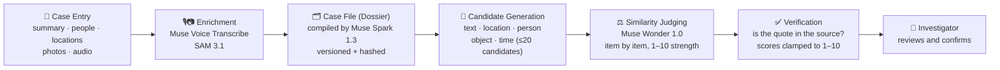

<div align="center">

**🇬🇧 English** · **[🇹🇷 Türkçe](README.tr.md)**

# TRACE<span>.</span>

### So past cases are never forgotten: an AI-powered investigation assistant that matches every clue entered into the system with similar cases in the archive

[](https://trace.51-20-67-60.sslip.io/login)
[](https://nextjs.org/)
[](https://react.dev/)
[](https://www.typescriptlang.org/)
[](#-tests)
[](https://ai.meta.com/)

Built for the **Meta Global AI Developer Hackathon** · *Indie Developer Track*

</div>

---

## 📑 Table of Contents

- [What Is Trace?](#-what-is-trace)
- [Why Was It Built? Problem & Solution](#-why-was-it-built-problem--solution)
- [Live Demo](#-live-demo)
- [Key Features](#-key-features)
- [How It Works](#-how-it-works)
- [Models Used](#-models-used)
- [Tech Stack](#-tech-stack)
- [Installation & Running](#-installation--running)
- [Configuration (Environment Variables)](#-configuration-environment-variables)
- [Deployment with Docker](#-deployment-with-docker)
- [Project Structure](#-project-structure)
- [API Endpoints](#-api-endpoints)
- [Tests](#-tests)
- [Security, Privacy & Responsible Use](#-security-privacy--responsible-use)
- [Known Limitations & Roadmap](#-known-limitations--roadmap)
- [Important Note](#-important-note)

---

## 🔍 What Is Trace?

**Trace** is a **case-recording and similar-case discovery system** designed for investigators working in homicide and major-crime units.

An investigator opens a new case in the system and enters the summary, people, locations, photos, and audio recordings. Trace uses **everything that case has** — not just the summary text, but also locations, people, interview transcripts, objects in evidence photos, and event timing — to search past cases in the archive and presents the similarities **one by one, together with their strength and the evidence they are based on**:

> *"TR-0014 is 8/10 similar to this case — because: approaching from behind at night by the water (9/10, evidence: '…'), the same SAM label 'knife' in both files (7/10), distance between locations 1.2 km (6/10)…"*

The system does not make decisions, does not declare suspects, and does not propose verdicts. **It presents candidates and shows its reasoning; the final confirmation always belongs to the investigator.**

---

## 🎯 Why Was It Built? Problem & Solution

### The Problem

Major-crime units handle hundreds of cases at once. The information that could help a case opened today most often sits inside a file **closed 5–20 years ago** — but that file is in nobody's memory:

- Closed cases disappear from institutional memory; experience leaves with retiring officers.
- Similarity search traditionally looks only at **shared words** in summary text. Two files describing the same event in different words never find each other.
- The strongest clues — an object in a photo, a sentence in an interview recording, the distance between two crime scenes — are **never included** in the search at all.
- Even when a match is found, there is no answer to *"why is it similar?"*; a black-box score builds no trust with investigators.

### The Solution

Trace solves this with a four-stage, multi-source, and **fully explainable** similarity pipeline:

| Traditional approach | Trace |
|---|---|
| Word matching in summary text only | Summary + crime type + method (MO) + weapon + **location/distance** + **people** + **interview transcripts** + **objects in photos** + **time window** |
| A single, unexplained similarity score | Every similarity is a **separate item**: its type, description, **1–10 strength**, and **source-verified evidence/quote** |
| Fixed score table ("same city = +2") | No fixed table; the **model decides** each match's strength by looking at the concrete content of that case pair — a rare, specific match naturally outweighs a generic one |
| Only open cases are searched | **Closed cases are in the candidate pool too** — the whole point of the system is to search the forgotten past |
| Record is lost when the connection drops | **Offline queue:** the record is stored in a queue and sent automatically when the connection returns |

This project was built from scratch for the **Meta Global AI Developer Hackathon (Indie Developer track)** by a single developer with AI assistance, in about one intensive week (October 27 – November 4). Target categories: **Best Build on Meta Open Weight Models** and **Best Agentic Use-Case**. The design deliberately goes beyond the "basic RAG" pattern: it is built on a multi-step agent pipeline (enrichment → compilation → candidate generation → judging → verification), multimodality (audio + photos), and grounded explanations. All AI models are from the **Meta family**; no non-Meta AI model is used.

> ⚠️ **Data note:** Trace runs entirely on **fictional data**. All 18 cases in the seed set are made up (`[Fiction]` prefix, `TR-SEED-*` numbers). Real case or personal data must never be entered into the system.

---

## 🚀 Live Demo

The project can be tried live:

<div align="center">

### 👉 Live Demo: [trace.51-20-67-60.sslip.io/login](https://trace.51-20-67-60.sslip.io/login)
### 🔑 Demo Password: `hackathontracedemo`

</div>

> ☁️ The live demo runs on an **AWS EC2** instance (Docker + Caddy, automatic HTTPS). It will be **shut down after the hackathon results are announced** — see the [Important Note](#-important-note) at the end.

### What can you see in the demo in 3 minutes?

1. **Opening a case (`/new`):** Only the incident summary is required. People (victim / witness / suspect badges, relationship to the victim, contact status) and locations (crime scene + critical location pins on the map, distance label between them) are added from a single screen.
2. **Similar-case discovery (`/cases/[id]`):** The "Similar Cases" panel on the case detail page shows the similarity search step by step with a live progress timeline and elapsed-time clock. Result cards show the case number, overall score (1–10), a short rationale, and **item-by-item similarities** (each with its strength and evidence quote). You can mark a match you like as **"confirmed"** with a single click.
3. **Audio and photo evidence (`/cases/[id]/add`):** Record a statement — **Muse Voice Transcribe** produces a speaker-separated transcript. Upload a crime-scene photo — **SAM 3.1** labels and boxes the objects in the photo.
4. **Offline operation:** Cut the connection and enter a record; the service worker queues the request, sends it automatically when the connection returns, and a "new similars" badge appears on the case.

> 💡 In the seed data, `TR-SEED-01…05` is the "waterfront | knife | approaching-from-behind-at-night" serial set; similarity results are strongest on this set.

---

## ✨ Key Features

- **📝 Easy case entry** — Only the incident summary is required; the case number (`TR-0001`…) is generated automatically, and everything else can be added later.
- **👥 Rich person model** — Victim / witness / suspect roles, unidentified-person support, relationship to a victim, contact status; an interview audio recording can be attached to a person.
- **🗺️ Map-based location model** — Crime scenes and related locations, priority levels, pins on a Leaflet map, distance label between two pins, address/place-name search (Nominatim).
- **🎙️ Audio → speaker-separated text** — Muse Voice Transcribe turns interview and evidence audio into transcripts with `A / B…` speaker labels.
- **📷 Photo → labeled objects** — SAM 3.1 marks objects in evidence photos with bounding boxes; the labels feed into the similarity calculation.
- **🧠 Multi-channel similarity** — Candidate generation from the union of text (FTS5), location (≤ 5 km), person (normalized name + role), object (SAM label), and time (± 90 days) channels; scoring belongs entirely to the model.
- **🔎 Verified-evidence requirement** — No quote produced by the model can enter a result unless it can be verified **verbatim** in the source file. Fabricated evidence is structurally impossible.
- **⏱️ Live search experience** — The similarity search streams stage by stage over NDJSON (enrichment → dossiers → candidates → scoring → verification); the remaining-time estimate is computed from past search statistics.
- **💾 Smart caching** — Case files are hashed; the same case pair is not re-scored unless its content changes. When new evidence is added, only affected pairs are refreshed.
- **📴 Offline operation** — Service Worker + IndexedDB queue; notes, audio, photos, and person/location updates are never lost without a connection and are sent automatically in FIFO order.
- **🛟 Graceful degradation** — If there is no API key, the model times out, or it returns malformed JSON, the system does not crash: candidates are listed as **"0 (not scored)"**, no record is ever lost, and scoring is retried once a key is available.
- **🤝 Human-confirmed linking** — The system only suggests; the "relevant" confirmation belongs to the investigator and can be undone.

---

## ⚙️ How It Works



### The similarity pipeline, step by step

1. **Enrichment** (`lib/enrichment.ts`) — When audio or an image is uploaded, a job enters the queue; Transcribe produces transcripts, SAM produces object marks. If a job fails, the record is not lost; the job is retried up to 3 times and scoring continues with the remaining data.
2. **Case file / Dossier** (`lib/dossier.ts`) — For each case, Muse Spark 1.3 compiles a compact, versioned, hashed dossier of the incident, locations, people (standout **verbatim** quotes from interview transcripts), and evidence, with every piece source-marked. The file is not rebuilt unless the content changes.
3. **Candidate generation** (`lib/candidates.ts`) — The union of 5 channels that never score, only make sure no strong candidate stays out of the pool: text (SQLite FTS5), location (≤ 5 km), person (English-normalized name + role), object (SAM label), time (± 90 days). Closed cases included, at most 20 candidates; multi-channel candidates come first.
4. **Scoring** (`lib/similarity.ts`) — Muse Wonder 1.0 compares all candidates in a **single call**. There is no fixed score table; it returns each similarity as a separate item with a content-based 1–10 strength and a holistic overall score. Up to 3 evidence images sharing a common SAM label are attached to the package for visual verification.
5. **Verification and persistence** — The code strictly validates the model output: unknown/duplicate `caseId`s are dropped, scores and strengths are clamped to 1–10, kinds outside the fixed similarity vocabulary are discarded, and **a quote that cannot be verified in the source cannot enter an item**. Results are stored in the `similar_results` table with file hashes; they are not re-scored unless content changes.
6. **Presentation** (`GET /api/cases/[id]/similar`) — Top 5 results by default (`SIMILAR_RESULT_LIMIT`). With `?stream=1`, the same endpoint streams NDJSON progress events; the case page shows them as a live timeline.

---

## 🤖 Models Used

All four Meta models in Trace work not as decoration, but **each in its natural job, as a separate link in the chain**:

| Model | Role | How it works | Code |
|---|---|---|---|
| **Muse Voice Transcribe** (`muse-voice-transcribe-1.0`) | 🎙️ Audio → speaker-separated text | `POST https://api.meta.ai/v1/asr/transcribe` · multipart (`request` JSON + `audio`) · `DIARIZATION` mode returns speaker-labeled turns in `turns[]` · WAV required: mono 16-bit PCM at 16/24 kHz, max 25 MB | `lib/transcribe.ts`, `lib/enrichment.ts` |
| **SAM 3.1** (`sam-3.1`) | 📷 Image → labeled/boxed objects | `POST https://api.meta.ai/v1/responses` · one short noun phrase per call (`input_text`, e.g. `knife`) + the photo (`input_image`, data URL) · boxes are parsed from output tokens and normalized to 0–1 | `lib/mark-photo.ts`, `lib/enrichment.ts` |
| **Muse Spark 1.3** (`muse-spark-1.3`) | 🗂️ Case-file compiler agent | Compiles a versioned dossier for each case; selects and summarizes standout statements from interview transcripts. Summaries are kept in a separate field — quotes always come verbatim from the source record, and model-generated summary text can never become "evidence" | `lib/glimmer-client.ts`, `lib/dossier.ts` |
| **Muse Wonder 1.0** (`muse-wonder-1.0`) | ⚖️ Similarity judge | Compares candidate files in a single call; lists similarities item by item with 1–10 strength and an overall score; uses up to 3 evidence images for multimodal verification. Called via the Meta API in the active setup | `lib/spark-client.ts`, `lib/similarity.ts` |

> **Role-based configuration:** In the codebase, roles are separated by task name — the file-compiler role is routed via `PROSECUTOR_*` env variables and the similarity-judge role via `JUDGE_*` (legacy `GLIMMER_*` / `META_*` names are still accepted for backward compatibility). This way model/endpoint changes are made from a single layer, without touching code. Without keys, the system keeps working with unscored fallback behavior.
>
> **Active setup and alternatives:** **Muse Spark 1.3** is currently active for file compilation and **Muse Wonder 1.0** for similarity judging. For security (keeping data from leaking outside, staying inside the organization) and to cut costs, **Muse Glimmer can be used instead of Muse Spark 1.3** and **Muse Spark Open instead of Muse Wonder 1.0** in the same roles, with no code change — only env variables. In particular, running Spark Open on the organization's own systems is the recommended path so that case data never leaves the organization.

### 🧑‍💻 Meta Models in the Development Process

Meta technologies were not only used at runtime — they shaped how Trace itself was designed and built:

| Stage | Meta technology | How it was used |
|---|---|---|
| **Ideation & software development** | **Muse Spark 1.3**, **Muse Wonder**, **Muse Code** | Used extensively throughout the development process: maturing the product idea, working through design decisions and trade-offs, and developing the software itself — from the similarity pipeline and model-role architecture to implementation, debugging, and review. The multi-model design of Trace (separate compiler and judge roles, verified-evidence rules, graceful degradation) was refined in this process. |
| **Test & demo assets** | **Muse Image 1.0** (`muse-image-1.0`) | Used **only** to produce fictional evidence photos for testing and the demo (e.g. the knife on the pier, the burnt cabin and gasoline can, the crowbar-marked door under `demo-assets/`). These synthetic images were used to exercise SAM 3.1 marking, the object candidate channel, and visual verification with safe, made-up material — never with real evidence. Image generation plays **no role in the runtime product**: Trace creates no imagery inside an investigation. |

This distinction matters: in the running system, models only *read* case material (transcribe, mark, compile, compare) and every claim they make is checked against the source; generative imagery exists solely as fictional test data created before any case is entered.

---

## 🛠️ Tech Stack

| Layer | Technology |
|---|---|
| **Framework** | Next.js 15 (App Router) · React 19 · TypeScript 5.7 |
| **Database** | SQLite (`better-sqlite3`, WAL mode) + FTS5 full-text search |
| **Maps** | Leaflet · Nominatim place search · Haversine distance calculation |
| **Offline** | Service Worker + IndexedDB outbox queue (FIFO replay; on 409 the server record wins) |
| **AI** | Meta Model API (OpenAI-compatible chat layer) · Muse Spark 1.3 · Muse Wonder 1.0 · Muse Voice Transcribe · SAM 3.1 |
| **Tests** | Vitest + Testing Library + jsdom — **41 files, 349 tests** |
| **Development** | Muse Spark 1.3 · Muse Wonder · Muse Code (ideation & software development) · Muse Image 1.0 (fictional test/demo evidence images only) |
| **Deployment** | Live demo hosted on **AWS EC2** · Docker (multi-stage, Node 22) · Docker Compose · Caddy (automatic HTTPS, reverse proxy) |
| **Interface** | A single web application with Next.js App Router |

---

## 💻 Installation & Running

### Requirements

- **Node.js 22 LTS** (recommended; 22.6+ required for the seed script)
- npm
- (For live model calls) a Meta Model API key — the app also runs without keys; similarities are then listed unscored
- `ffmpeg` if audio needs converting (for non-WAV formats)

### Quick start

```bash
# 1) Install dependencies
npm install

# 2) Set environment variables (see the table below)
cp .env.example .env.local   # or create .env.local manually

# 3) Start the development server
npm run dev                  # http://localhost:3000

# 4) In a separate terminal, load the 18 fictional cases (while the server is running)
npm run seed
```

PowerShell example:

```powershell
$env:MODEL_API_KEY="..."
$env:DEMO_PASSCODE="choose-your-own-password"
npm run dev
```

When the app opens, it asks for the shared demo login (if `DEMO_PASSCODE` is set); after signing in, the case list, new-case form, and case details are available.

### Audio format note

Transcribe only accepts **WAV (mono, 16-bit PCM, 16/24 kHz)**. Convert other formats first:

```bash
ffmpeg -i recording.m4a -ac 1 -ar 24000 -c:a pcm_s16le recording.wav
```

---

## 🔐 Configuration (Environment Variables)

Keys are read **only** from environment variables; there are no hard-coded keys in the code. The primary key is `MODEL_API_KEY` (Transcribe, SAM, and chat share the same Bearer key); `META_API_KEY` / `LLAMA_API_KEY` are accepted as fallbacks.

| Variable | Description |
|---|---|
| `DEMO_PASSCODE` | Demo login password (login is impossible if not set; check: `lib/demo-auth.ts`) |
| `MODEL_API_KEY` | Primary Meta Model API key (Transcribe + SAM 3.1 + chat) |
| `META_API_KEY` / `LLAMA_API_KEY` | Fallback keys |
| `PROSECUTOR_API_URL` / `PROSECUTOR_MODEL` / `PROSECUTOR_API_KEY` | File-compiler endpoint / model / key (active model: `muse-spark-1.3`) — legacy `GLIMMER_*` names are also accepted |
| `JUDGE_API_URL` / `JUDGE_MODEL` | Similarity-judge endpoint (full chat-completions URL) / model (active model: `muse-wonder-1.0`) — legacy `META_API_URL` / `META_MODEL` are also accepted |
| `BASETEN_API_KEY` | If set, the judge is called via Baseten |
| `BASETEN_API_URL` | Baseten endpoint (default: `https://inference.baseten.co/v1/chat/completions`) |
| `SPARK_MODEL` | Judge model name on the Baseten path (default: `muse-spark-open`) |
| `META_TRANSCRIBE_URL` / `META_TRANSCRIBE_MODEL` | Transcribe endpoint / model (default: `muse-voice-transcribe-1.0`) |
| `META_SAM_URL` / `META_SAM_MODEL` | SAM endpoint / model (default: `sam-3.1`) |
| `SIMILAR_RESULT_LIMIT` | Number of similar cases shown (default: 5) |
| `SPARK_TIMEOUT_MS` | Judge call timeout, ms (default: 120000) |
| `META_TIMEOUT_MS` / `GLIMMER_TIMEOUT_MS` / `META_TRANSCRIBE_TIMEOUT_MS` / `META_SAM_TIMEOUT_MS` | Model call timeouts, ms (default: 120000) |
| `TRACE_DB_PATH` / `TRACE_UPLOAD_DIR` | SQLite file / upload directory (defaults: `trace.db` / `uploads`) |
| `TRACE_BASE_URL` | Seed target (default: `http://localhost:3000`) |
| `SITE_ADDRESS` | Prod profile only: Caddy site address (domain for automatic HTTPS, or `:80` for HTTP) |

---

## 🐳 Deployment with Docker

```bash
# Build and start the app (data persists under ./data)
docker compose up -d --build

# Prod profile: including Caddy with automatic HTTPS
docker compose --profile prod up -d
```

- The app listens only on `127.0.0.1:3000` on the host; it is exposed externally through Caddy.
- Persistent data (SQLite + uploads) is kept outside the container, in the host `./data` folder.
- The production image is multi-stage: `deps → build → runner` (Node 22, runs as the `node` user).

---

## 📁 Project Structure

```text
Trace/
├── app/                        # Next.js App Router
│   ├── page.tsx                # Case list (home page)
│   ├── login/                  # Demo login screen
│   ├── new/                    # New-case form
│   ├── cases/[id]/             # Case detail, similar cases, add evidence
│   ├── api/cases/              # REST API (cases, people, locations, evidence, similarity…)
│   └── components/             # Map, person/location editors, similarity cards, live progress
├── lib/
│   ├── transcribe.ts           # Muse Voice Transcribe client
│   ├── mark-photo.ts           # SAM 3.1 marking client
│   ├── glimmer-client.ts       # File-compiler (PROSECUTOR) client
│   ├── spark-client.ts         # Similarity-judge (JUDGE) client
│   ├── dossier.ts              # Versioned case-file compilation
│   ├── candidates.ts           # 5-channel candidate generation
│   ├── similarity.ts           # Judge scoring + output validation + caching
│   ├── enrichment.ts           # Background enrichment job queue
│   ├── db.ts                   # SQLite schema (FTS5, job queue, result cache)
│   └── …                       # outbox, location/distance, search-time estimation, etc.
├── public/sw.js                # Service Worker — offline request queue
├── seed/                       # 18 fictional cases (cases.json) + seed script
├── tests/                      # 349 Vitest tests in 41 files
├── Dockerfile · docker-compose.yml · Caddyfile
├── README.md                   # English (default)
└── README.tr.md                # Türkçe
```

---

## 🔌 API Endpoints

| Method & Path | Description |
|---|---|
| `GET /api/health` | Health check |
| `GET / POST /api/cases` | Case list / new case |
| `GET / PATCH /api/cases/[id]` | Case detail / update |
| `GET / POST / PATCH / DELETE /api/cases/[id]/persons…` | People and interview audio |
| `GET / POST / PATCH / DELETE /api/cases/[id]/locations…` | Locations |
| `GET / POST / DELETE /api/cases/[id]/evidences…` | Evidence (photo, audio, note) |
| `POST /api/cases/[id]/transcribe` | Transcribe audio evidence (Muse Voice Transcribe) |
| `POST /api/cases/[id]/mark-photo` | Mark objects in a photo (SAM 3.1) |
| `GET /api/cases/[id]/similar` | Similar cases — NDJSON live progress stream with `?stream=1` |
| `POST /api/cases/[id]/links` | Confirm a match as "relevant" |
| `GET /api/files/[name]` | Serve an uploaded file |

---

## ✅ Tests

```bash
npm test        # Vitest — 41 test files, 349 tests
npm run build   # Production build (including type checking)
```

Tests run without network access; model clients are replaced with fake clients in tests. Coverage includes the candidate channels, dossier hash/cache behavior, quote verification, the enrichment retry contract, the offline queue, and the API endpoints.

---

## 🔒 Security, Privacy & Responsible Use

- **Not a decision-maker:** Trace does not declare suspects and does not propose verdicts or priorities. Similarity is a *candidate list*; the link confirmation belongs to the investigator.
- **Fictional data:** The demo and seed set are entirely made up. Real case/personal data must not be entered.
- **Key hygiene:** All API keys live only in env variables; there are no keys in the repo.
- **API mode (v1 reality):** v1 runs in API mode only; person names and transcripts are sent to the model as-is. Running Muse Spark Open on the unit's own systems instead of Muse Wonder 1.0 for similarity judging (so data never leaves the organization) is the product's privacy roadmap; since model access goes through a single chat layer routed by env, the interface and scoring behavior stay exactly the same if self-hosting is set up.
- **Grounded explanations:** No quote that cannot be verified in the source can be shown to the user as "evidence".

---

## 🗺️ Known Limitations & Roadmap

- Word-based FTS pre-filtering is weak for morphologically rich languages (affixes, synonyms); multi-channel candidate generation and the model's semantic decision compensate for this but do not eliminate it entirely.
- Similarity evaluation carries cost/latency proportional to the number of candidates; that is why candidates are capped at ≤ 20 and files are kept pre-compiled (cached).
- In v1, user confirmations do not train the ranking model; they are for record-keeping only.
- Self-hosting (running Muse Spark Open inside the organization) is not set up in v1; it is on the roadmap.
- There are no roles/permissions; a single shared demo login is used.

---

## 📌 Important Note

> **The live demo site (linked in the Live Demo section above) runs on an AWS EC2 instance and will be shut down after the hackathon results are announced.** After evaluation, the project will no longer be accessible at that address; to inspect the project, you can run it locally using the installation steps in this repo.

---

<div align="center">

**TRACE.** — *Recording, similarity, evidence, and an offline queue; with entirely fictional data, and a real division of labor among four Meta models.*

</div>
