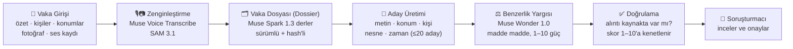

<div align="center">

**[🇬🇧 English](README.md)** · **🇹🇷 Türkçe**

# TRACE<span>.</span>

### Geçmiş vakalar unutulmasın diye: sisteme girilen her ipucunu arşivdeki benzer vakalarla buluşturan yapay zekâ destekli soruşturma asistanı

[](https://trace.51-20-67-60.sslip.io/login)
[](https://nextjs.org/)
[](https://react.dev/)
[](https://www.typescriptlang.org/)
[](#-testler)
[](https://ai.meta.com/)

**Meta Global AI Developer Hackathon** · *Indie Developer Track* için geliştirildi

</div>

---

## 📑 İçindekiler

- [Proje Nedir?](#-proje-nedir)
- [Neden Yapıldı? Problem ve Çözüm](#-neden-yapıldı-problem-ve-çözüm)
- [Canlı Demo](#-canlı-demo)
- [Öne Çıkan Özellikler](#-öne-çıkan-özellikler)
- [Nasıl Çalışır?](#-nasıl-çalışır)
- [Kullanılan Modeller](#-kullanılan-modeller)
- [Teknoloji Yığını](#-teknoloji-yığını)
- [Kurulum ve Çalıştırma](#-kurulum-ve-çalıştırma)
- [Yapılandırma (Environment Variables)](#-yapılandırma-environment-variables)
- [Docker ile Dağıtım](#-docker-ile-dağıtım)
- [Proje Yapısı](#-proje-yapısı)
- [API Uç Noktaları](#-api-uç-noktaları)
- [Testler](#-testler)
- [Güvenlik, Gizlilik ve Sorumlu Kullanım](#-güvenlik-gizlilik-ve-sorumlu-kullanım)
- [Bilinen Sınırlamalar ve Yol Haritası](#-bilinen-sınırlamalar-ve-yol-haritası)
- [Önemli Not](#-önemli-not)

---

## 🔍 Proje Nedir?

**Trace**, cinayet ve ağır suç birimlerinde çalışan soruşturmacılar için tasarlanmış, **bir vaka kayıt ve benzer vaka keşif sistemidir.**

Bir soruşturmacı sisteme yeni bir vaka açar; özet, kişiler, konumlar, fotoğraflar ve ses kayıtları girer. Trace, bu vakanın elindeki **her bilgiyi** — yalnızca özet metnini değil; konumları, kişileri, sorgu transkriptlerini, delil fotoğraflarındaki nesneleri ve olay zamanını da — kullanarak arşivdeki geçmiş vakaları tarar ve **benzerlikleri tek tek, gücü ve dayandığı kanıtla birlikte** sunar:

> *"TR-0014 bu vakaya 8/10 benziyor — çünkü: gece su kenarında arkadan yaklaşma (9/10, kanıt: '…'), iki dosyada da aynı SAM etiketi 'knife' (7/10), konumlar arası mesafe 1,2 km (6/10)…"*

Sistem karar vermez, şüpheli ilan etmez, hüküm önermez. **Aday sunar, gerekçesini gösterir; son onayı her zaman soruşturmacı verir.**

---

## 🎯 Neden Yapıldı? Problem ve Çözüm

### Problem

Ağır suç birimleri yüzlerce vakayla aynı anda uğraşır. Bugün açılan bir vakaya en çok yardım edebilecek bilgi, çoğu zaman **5–20 yıl önce kapanmış bir dosyanın** içindedir — ama o dosya kimsenin hafızasında değildir:

- Kapanmış vakalar kurumsal hafızadan silinir; deneyim, emekli olan memurla birlikte gider.
- Benzerlik araması geleneksel olarak yalnızca özet metnindeki **kelime ortaklığına** bakar. Aynı olayı farklı kelimelerle anlatan iki dosya birbirini hiç bulamaz.
- Fotoğraftaki nesne, sorgu kaydındaki bir cümle, iki olay yeri arasındaki mesafe gibi en güçlü ipuçları arama hesabına **hiç katılmaz**.
- Bir eşleşme bulunsa bile *"neden benziyor?"* sorusunun cevabı yoktur; kara kutu skor soruşturmacıda güven oluşturmaz.

### Çözüm

Trace bu problemi dört aşamalı, çok kaynaklı ve **tamamen açıklanabilir** bir benzerlik hattıyla çözer:

| Geleneksel yaklaşım | Trace |
|---|---|
| Yalnızca özet metninde kelime eşleşmesi | Özet + suç tipi + yöntem (MO) + silah + **konum/mesafe** + **kişiler** + **sorgu transkriptleri** + **fotoğraftaki nesneler** + **zaman penceresi** |
| Tek, açıklamasız benzerlik skoru | Her benzerlik **ayrı bir madde**: türü, açıklaması, **1–10 gücü** ve **kaynakta doğrulanmış kanıtı/alıntısı** ile |
| Sabit puan tablosu ("aynı şehir = +2") | Sabit tablo yok; her eşleşmenin gücüne, o vaka çiftinin somut içeriğine bakarak **model karar verir** — nadir ve spesifik eşleşme, genel eşleşmeden doğal olarak ağır basar |
| Yalnızca açık vakalar taranır | **Kapalı vakalar da aday havuzundadır** — sistemin asıl amacı zaten unutulmuş geçmişi taramaktır |
| Bağlantı kesilirse kayıt kaybolur | **Çevrimdışı kuyruk:** kayıt kuyrukta saklanır, bağlantı gelince kendiliğinden gönderilir |

Bu proje, **Meta Global AI Developer Hackathon (Indie Developer track)** kapsamında, tek geliştirici + yapay zekâ desteğiyle yaklaşık bir haftalık yoğun bir çalışmayla (27 Ekim – 4 Kasım) sıfırdan geliştirilmiştir. Hedef kategoriler: **Best Build on Meta Open Weight Models** ve **Best Agentic Use-Case**. Tasarım bilinçli olarak "basic RAG" kalıbının ötesine geçer: çok adımlı ajan hattı (zenginleştirme → derleme → aday üretimi → yargılama → doğrulama), çoklu ortam (ses + fotoğraf) ve dayanaklı açıklamalar üzerine kuruludur. Tüm yapay zekâ modelleri **Meta ailesindendir**; Meta dışı hiçbir yapay zekâ modeli kullanılmamıştır.

> ⚠️ **Veri notu:** Trace tamamen **kurgusal verilerle** çalışır. Seed setindeki 18 vakanın tamamı hayal ürünüdür (`[Fiction]` ön eki, `TR-SEED-*` numaraları). Sisteme gerçek vaka veya kişisel veri girilmemelidir.

---

## 🚀 Canlı Demo

Proje şu adresten canlı olarak denenebilir:

<div align="center">

### 👉 [trace.51-20-67-60.sslip.io/login](https://trace.51-20-67-60.sslip.io/login)

| | |
|---|---|
| **Demo Adresi** | https://trace.51-20-67-60.sslip.io/login |
| **Demo Şifresi** | `hackathontracedemo` |

### 🔑 Demo Şifresi: `hackathontracedemo`

</div>

### Demoda 3 dakikada neler görebilirsiniz?

1. **Vaka açma (`/new`):** Yalnızca olay özeti zorunludur. Kişiler (maktul / tanık / şüpheli rozetleri, mağdurla ilişki, ulaşılma durumu) ve konumlar (harita üzerinde suç mahalli + kritik konum iğneleri, aralarındaki mesafe etiketi) tek ekrandan eklenir.
2. **Benzer vaka keşfi (`/cases/[id]`):** Vaka detayında "Similar Cases" paneli; canlı ilerleme zaman çizelgesi ve geçen süre sayacıyla benzerlik aramasını adım adım izletir. Sonuç kartlarında vaka numarası, genel puan (1–10), kısa gerekçe ve **madde madde benzerlikler** (her biri gücü ve kanıt alıntısıyla) yer alır. Beğendiğiniz eşleşmeyi tek tıkla **"confirmed / alakalı"** olarak işaretleyebilirsiniz.
3. **Ses ve fotoğraf delilleri (`/cases/[id]/add`):** İfade kaydedin — **Muse Voice Transcribe** konuşmacı ayrımlı transkript üretsin. Olay yeri fotoğrafı yükleyin — **SAM 3.1** fotoğraftaki nesneleri etiketleyip kutulasın.
4. **Çevrimdışı çalışma:** Bağlantıyı kesin, kayıt girin; service worker isteği kuyruğa alır, bağlantı dönünce otomatik gönderir ve vakada "yeni benzerler" rozeti belirir.

> 💡 Seed verisindeki `TR-SEED-01…05`, "su kenarı | bıçak | gece arkadan yaklaşma" seri setidir; benzerlik sonuçları en güçlü bu set üzerinde görülür.

---

## ✨ Öne Çıkan Özellikler

- **📝 Kolay vaka girişi** — Tek zorunlu alan olay özetidir; vaka numarası (`TR-0001`…) otomatik üretilir, gerisi sonradan eklenebilir.
- **👥 Zengin kişi modeli** — Maktul / tanık / şüpheli rolleri, kimliği belirsiz kişi desteği, mağdurla ilişki bağı, ulaşılma durumu; kişiye sorgu ses kaydı eklenebilir.
- **🗺️ Haritalı konum modeli** — Suç mahalli ve ilişkili konumlar, öncelik seviyeleri, Leaflet haritası üzerinde iğneler, iki iğne arası mesafe etiketi, adres/yer adı araması (Nominatim).
- **🎙️ Ses → konuşmacı ayrımlı metin** — Muse Voice Transcribe ile sorgu ve delil sesleri `A / B…` konuşmacı etiketli transkripte dönüşür.
- **📷 Fotoğraf → etiketli nesneler** — SAM 3.1, delil fotoğraflarındaki nesneleri sınırlayıcı kutularla işaretler; etiketler benzerlik hesabına katılır.
- **🧠 Çok kanallı benzerlik** — Metin (FTS5), konum (≤ 5 km), kişi (normalize ad + rol), nesne (SAM etiketi) ve zaman (± 90 gün) kanallarının birleşimiyle aday üretimi; puanlama tamamen modelindir.
- **🔎 Doğrulanmış kanıt zorunluluğu** — Modelin ürettiği hiçbir alıntı, kaynak dosyada kelimesi kelimesine doğrulanamazsa sonuca **giremez**. Uydurma kanıt yapısal olarak imkânsızdır.
- **⏱️ Canlı arama deneyimi** — Benzerlik araması NDJSON akışıyla aşama aşama (zenginleştirme → dosyalar → adaylar → puanlama → doğrulama) canlı izlenir; kalan süre tahmini geçmiş arama istatistiklerinden hesaplanır.
- **💾 Akıllı önbellek** — Vaka dosyaları hash'lenir; içerik değişmedikçe aynı vaka çifti yeniden puanlanmaz. Yeni delil eklenirse yalnızca etkilenen çiftler tazelenir.
- **📴 Çevrimdışı çalışma** — Service Worker + IndexedDB kuyruğu; not, ses, fotoğraf, kişi ve konum güncellemeleri bağlantı yokken bile kaybolmaz, FIFO sırasıyla otomatik gönderilir.
- **🛟 Zarif bozulma (graceful degradation)** — API anahtarı yoksa, model zaman aşımına uğrarsa veya bozuk JSON dönerse sistem çökmez: adaylar **"0 (not scored)"** olarak listelenir, kayıt asla kaybolmaz, puanlama anahtar gelince tekrar denenir.
- **🤝 İnsan onaylı bağlantı** — Sistem yalnızca önerir; "alakalı" onayı soruşturmacınındır ve geri alınabilir.

---

## ⚙️ Nasıl Çalışır?



### Adım adım benzerlik hattı

1. **Zenginleştirme** (`lib/enrichment.ts`) — Ses veya görüntü yüklendiğinde bir iş kuyruğa girer; Transcribe transkript, SAM nesne işaretleri üretir. İş başarısız olursa kayıt kaybolmaz; iş en fazla 3 kez yeniden denenir, puanlama kalan veriyle sürer.
2. **Vaka dosyası / Dossier** (`lib/dossier.ts`) — Her vaka için Muse Spark 1.3; olay, konumlar, kişiler (sorgu transkriptlerinden öne çıkan **kelimesi kelimesine** ifadeler) ve delillerden oluşan, her parçası kaynak işaretli, sürümlü ve hash'li kompakt bir derleme üretir. İçerik değişmedikçe dosya yeniden üretilmez.
3. **Aday üretimi** (`lib/candidates.ts`) — Puan vermeyen, yalnızca "güçlü hiçbir aday havuz dışında kalmasın" diye çalışan 5 kanalın birleşimi: metin (SQLite FTS5), konum (≤ 5 km), kişi (İngilizce-normalize ad + rol), nesne (SAM etiketi), zaman (± 90 gün). Kapalı vakalar dahil, en fazla 20 aday; çok kanallı adaylar öne alınır.
4. **Puanlama** (`lib/similarity.ts`) — Muse Wonder 1.0, tüm adayları **tek çağrıda** karşılaştırır. Sabit puan tablosu yoktur; her benzerliği ayrı madde olarak, içeriğe bakarak 1–10 güçle ve bütünsel bir genel skorla döndürür. Ortak SAM etiketi taşıyan en fazla 3 delil görseli, görsel doğrulama için pakete eklenir.
5. **Doğrulama ve kalıcılık** — Kod model çıktısını titizlikle doğrular: bilinmeyen/tekrarlanan `caseId` düşer, skor ve güçler 1–10 aralığına kenetlenir, sabit benzerlik sözlüğü dışındaki türler elenir ve **kaynakta doğrulanamayan alıntı maddeye giremez**. Sonuçlar dosya hash'leriyle `similar_results` tablosuna yazılır; içerik değişmedikçe yeniden puanlanmaz.
6. **Sunum** (`GET /api/cases/[id]/similar`) — Varsayılan ilk 5 sonuç (`SIMILAR_RESULT_LIMIT`). Aynı uç nokta `?stream=1` ile NDJSON ilerleme olayları akıtır; vaka sayfası bunları canlı zaman çizelgesi olarak gösterir.

---

## 🤖 Kullanılan Modeller

Trace'te dört Meta modeli de süs olarak değil, **her biri kendi doğal işinde, zincirin ayrı bir halkasında** gerçekten çalışır:

| Model | Rol | Nasıl çalışıyor? | Kod |
|---|---|---|---|
| **Muse Voice Transcribe** (`muse-voice-transcribe-1.0`) | 🎙️ Ses → konuşmacı ayrımlı metin | `POST https://api.meta.ai/v1/asr/transcribe` · multipart (`request` JSON + `audio`) · `DIARIZATION` modu `turns[]` ile konuşmacı etiketli dönüşler verir · WAV şartı: mono 16-bit PCM, 16/24 kHz, en fazla 25 MB | `lib/transcribe.ts`, `lib/enrichment.ts` |
| **SAM 3.1** (`sam-3.1`) | 📷 Görsel → etiketli/kutulu nesneler | `POST https://api.meta.ai/v1/responses` · kavram başına tek kısa isim öbeği (`input_text`, örn. `knife`) + fotoğraf (`input_image`, data URL) · kutular çıktı token'larından ayrıştırılır, 0–1 aralığına normalize edilir | `lib/mark-photo.ts`, `lib/enrichment.ts` |
| **Muse Spark 1.3** (`muse-spark-1.3`) | 🗂️ Vaka dosyası derleyici ajan | Her vaka için sürümlü dossier derler; sorgu transkriptlerinden öne çıkan ifadeleri seçer ve özetler. Özetler ayrı alanda tutulur — alıntılar her zaman kaynak kayıttan kelimesi kelimesine gelir, modelin ürettiği özet metni asla "kanıt" olamaz | `lib/glimmer-client.ts`, `lib/dossier.ts` |
| **Muse Wonder 1.0** (`muse-wonder-1.0`) | ⚖️ Benzerlik yargıcı | Aday dosyalarını tek çağrıda karşılaştırır; benzerlikleri madde madde, 1–10 güç ve genel skorla listeler; en fazla 3 delil görselini çok modlu doğrulamada kullanır. Aktif kurulumda Meta API üzerinden çağrılır | `lib/spark-client.ts`, `lib/similarity.ts` |

> **Rol bazlı yapılandırma:** Kod tabanında roller görev adlarıyla ayrılır — dosya derleyici rol `PROSECUTOR_*`, benzerlik yargıcı rol `JUDGE_*` env değişkenleriyle yönlendirilir (eski `GLIMMER_*` / `META_*` adları geriye dönük uyumluluk için kabul edilir). Böylece model/endpoint değişimi tek katmandan, kod değiştirmeden yapılır. Anahtarsız ortamda sistem puansız yedek davranışla çalışmaya devam eder.
>
> **Aktif kurulum ve alternatifler:** Şu an aktif olarak dosya derlemede **Muse Spark 1.3**, benzerlik yargısında **Muse Wonder 1.0** kullanılmaktadır. Güvenlik (verinin dışarı sızmaması, kurum içinde kalması) ve maliyetlerin kısılması açısından, aynı rollerde kod değişikliği yapmadan yalnızca env değişkenleriyle **Muse Spark 1.3 yerine Muse Glimmer**, **Muse Wonder 1.0 yerine Muse Spark Open** kullanılabilir; özellikle Spark Open'ın kurumun kendi sistemlerinde çalıştırılması, vaka verisinin kurum dışına çıkmaması için önerilen yoldur.

---

## 🛠️ Teknoloji Yığını

| Katman | Teknoloji |
|---|---|
| **Framework** | Next.js 15 (App Router) · React 19 · TypeScript 5.7 |
| **Veritabanı** | SQLite (`better-sqlite3`, WAL modu) + FTS5 tam metin arama |
| **Harita** | Leaflet · Nominatim yer arama · Haversine mesafe hesabı |
| **Çevrimdışı** | Service Worker + IndexedDB outbox kuyruğu (FIFO tekrar gönderim, 409'da sunucu kaydı kazanır) |
| **Yapay zekâ** | Meta Model API (OpenAI uyumlu chat katmanı) · Muse Spark 1.3 · Muse Wonder 1.0 · Muse Voice Transcribe · SAM 3.1 |
| **Test** | Vitest + Testing Library + jsdom — **41 dosya, 349 test** |
| **Dağıtım** | Docker (çok aşamalı, Node 22) · Docker Compose · Caddy (otomatik HTTPS, ters proxy) |
| **Arayüz** | Next.js App Router ile tek web uygulaması |

---

## 💻 Kurulum ve Çalıştırma

### Gereksinimler

- **Node.js 22 LTS** (önerilir; seed scripti için 22.6+ gerekir)
- npm
- (Canlı model çağrıları için) Meta Model API anahtarı — anahtarsız da çalışır, benzerlikler puansız listelenir
- Ses dönüştürme gerekiyorsa `ffmpeg` (WAV dışı formatlar için)

### Hızlı başlangıç

```bash
# 1) Bağımlılıkları kurun
npm install

# 2) Ortam değişkenlerini ayarlayın (aşağıdaki tabloya bakın)
cp .env.example .env.local   # yoksa .env.local dosyasını elle oluşturun

# 3) Geliştirme sunucusunu başlatın
npm run dev                  # http://localhost:3000

# 4) Ayrı bir terminalde 18 kurgusal vakayı yükleyin (sunucu çalışırken)
npm run seed
```

PowerShell örneği:

```powershell
$env:MODEL_API_KEY="..."
$env:DEMO_PASSCODE="hackathontracedemo"
npm run dev
```

Uygulama açıldığında paylaşımlı demo girişi (`DEMO_PASSCODE` tanımlıysa) ister; giriş sonrası vaka listesi, yeni vaka formu ve vaka detayları kullanılabilir.

### Ses formatı notu

Transcribe yalnızca **WAV (mono, 16-bit PCM, 16/24 kHz)** kabul eder. Başka formattaki kaydı önce dönüştürün:

```bash
ffmpeg -i kayit.m4a -ac 1 -ar 24000 -c:a pcm_s16le kayit.wav
```

---

## 🔐 Yapılandırma (Environment Variables)

Anahtarlar **yalnızca** ortam değişkenlerinden okunur; kodda sabit anahtar yoktur. Birincil anahtar `MODEL_API_KEY`'dir (Transcribe, SAM ve chat aynı Bearer anahtarını paylaşır); `META_API_KEY` / `LLAMA_API_KEY` yedek olarak kabul edilir.

| Değişken | Açıklama |
|---|---|
| `DEMO_PASSCODE` | Demo giriş şifresi (tanımlı değilse giriş yapılamaz; kontrol: `lib/demo-auth.ts`) |
| `MODEL_API_KEY` | Birincil Meta Model API anahtarı (Transcribe + SAM 3.1 + chat) |
| `META_API_KEY` / `LLAMA_API_KEY` | Yedek anahtarlar |
| `PROSECUTOR_API_URL` / `PROSECUTOR_MODEL` / `PROSECUTOR_API_KEY` | Dosya derleyici endpoint / model / anahtar (aktif model: `muse-spark-1.3`) — eski `GLIMMER_*` adları da kabul edilir |
| `JUDGE_API_URL` / `JUDGE_MODEL` | Benzerlik yargıcı endpoint (tam chat-completions URL'i) / model (aktif model: `muse-wonder-1.0`) — eski `META_API_URL` / `META_MODEL` da kabul edilir |
| `BASETEN_API_KEY` | Tanımlıysa yargıç, Baseten üzerinden çağrılır |
| `BASETEN_API_URL` | Baseten endpoint (varsayılan: `https://inference.baseten.co/v1/chat/completions`) |
| `SPARK_MODEL` | Baseten yolunda yargıç model adı (varsayılan: `muse-spark-open`) |
| `META_TRANSCRIBE_URL` / `META_TRANSCRIBE_MODEL` | Transcribe endpoint / model (varsayılan: `muse-voice-transcribe-1.0`) |
| `META_SAM_URL` / `META_SAM_MODEL` | SAM endpoint / model (varsayılan: `sam-3.1`) |
| `SIMILAR_RESULT_LIMIT` | Gösterilen benzer vaka sayısı (varsayılan: 5) |
| `SPARK_TIMEOUT_MS` | Yargıç çağrı zaman aşımı, ms (varsayılan: 120000) |
| `META_TIMEOUT_MS` / `GLIMMER_TIMEOUT_MS` / `META_TRANSCRIBE_TIMEOUT_MS` / `META_SAM_TIMEOUT_MS` | Model çağrı zaman aşımları, ms (varsayılan: 120000) |
| `TRACE_DB_PATH` / `TRACE_UPLOAD_DIR` | SQLite dosyası / yükleme dizini (varsayılan: `trace.db` / `uploads`) |
| `TRACE_BASE_URL` | Seed hedefi (varsayılan: `http://localhost:3000`) |
| `SITE_ADDRESS` | Yalnızca prod profili: Caddy site adresi (otomatik HTTPS için alan adı veya HTTP için `:80`) |

---

## 🐳 Docker ile Dağıtım

```bash
# Uygulamayı derleyip başlatın (veri ./data altında kalıcıdır)
docker compose up -d --build

# Prod profili: Caddy ile otomatik HTTPS dahil
docker compose --profile prod up -d
```

- Uygulama host üzerinde yalnızca `127.0.0.1:3000` portunu dinler; dışarıya Caddy üzerinden açılır.
- Kalıcı veri (SQLite + yüklemeler) container dışında, host `./data` klasöründe tutulur.
- Üretim image'ı çok aşamalıdır: `deps → build → runner` (Node 22, `node` kullanıcısıyla çalışır).

---

## 📁 Proje Yapısı

```text
Trace/
├── app/                        # Next.js App Router
│   ├── page.tsx                # Vaka listesi (ana sayfa)
│   ├── login/                  # Demo giriş ekranı
│   ├── new/                    # Yeni vaka açma formu
│   ├── cases/[id]/             # Vaka detayı, benzer vakalar, delil ekleme
│   ├── api/cases/              # REST API (vakalar, kişiler, konumlar, deliller, benzerlik…)
│   └── components/             # Harita, kişi/konum editörleri, benzerlik kartları, canlı ilerleme
├── lib/
│   ├── transcribe.ts           # Muse Voice Transcribe istemcisi
│   ├── mark-photo.ts           # SAM 3.1 işaretleme istemcisi
│   ├── glimmer-client.ts       # Dosya derleyici (PROSECUTOR) istemcisi
│   ├── spark-client.ts         # Benzerlik yargıcı (JUDGE) istemcisi
│   ├── dossier.ts              # Sürümlü vaka dosyası derleme
│   ├── candidates.ts           # 5 kanallı aday üretimi
│   ├── similarity.ts           # Yargıç puanlama + çıktı doğrulama + önbellek
│   ├── enrichment.ts           # Arka plan zenginleştirme iş kuyruğu
│   ├── db.ts                   # SQLite şeması (FTS5, iş kuyruğu, sonuç önbelleği)
│   └── …                       # outbox, konum/mesafe, arama süresi tahmini vb.
├── public/sw.js                # Service Worker — çevrimdışı istek kuyruğu
├── seed/                       # 18 kurgusal vaka (cases.json) + seed scripti
├── tests/                      # 41 dosyada 349 Vitest testi
├── Dockerfile · docker-compose.yml · Caddyfile
├── README.md                   # English (default)
└── README.tr.md                # Türkçe
```

---

## 🔌 API Uç Noktaları

| Metot & Yol | Açıklama |
|---|---|
| `GET /api/health` | Sağlık kontrolü |
| `GET / POST /api/cases` | Vaka listesi / yeni vaka |
| `GET / PATCH /api/cases/[id]` | Vaka detayı / güncelleme |
| `GET / POST / PATCH / DELETE /api/cases/[id]/persons…` | Kişiler ve sorgu sesleri |
| `GET / POST / PATCH / DELETE /api/cases/[id]/locations…` | Konumlar |
| `GET / POST / DELETE /api/cases/[id]/evidences…` | Deliller (fotoğraf, ses, not) |
| `POST /api/cases/[id]/transcribe` | Ses delilini transkript et (Muse Voice Transcribe) |
| `POST /api/cases/[id]/mark-photo` | Fotoğraftaki nesneleri işaretle (SAM 3.1) |
| `GET /api/cases/[id]/similar` | Benzer vakalar — `?stream=1` ile NDJSON canlı ilerleme akışı |
| `POST /api/cases/[id]/links` | Eşleşmeyi "alakalı" olarak onayla |
| `GET /api/files/[name]` | Yüklenen dosyayı sun |

---

## ✅ Testler

```bash
npm test        # Vitest — 41 test dosyası, 349 test
npm run build   # Üretim derlemesi (tip kontrolü dahil)
```

Testler ağ erişimi olmadan çalışır; model istemcileri testlerde sahte (fake) istemcilerle değiştirilir. Kapsam; aday kanalları, dossier hash/önbellek davranışı, alıntı doğrulama, zenginleştirme yeniden deneme sözleşmesi, çevrimdışı kuyruk ve API uç noktalarını içerir.

---

## 🔒 Güvenlik, Gizlilik ve Sorumlu Kullanım

- **Karar verici değildir:** Trace şüpheli ilan etmez, hüküm veya öncelik önermez. Benzerlik bir *aday listesidir*; bağlantı onayını soruşturmacı verir.
- **Kurgusal veri:** Demo ve seed seti tamamen hayal ürünüdür. Gerçek vaka/kişisel veri girilmemelidir.
- **Anahtar hijyeni:** Tüm API anahtarları yalnızca env değişkenlerindedir; repoda anahtar bulunmaz.
- **API modu (v1 gerçeği):** v1 yalnızca API modunda çalışır; kişi adları ve transkriptler modele olduğu gibi gider. Benzerlik yargısında Muse Wonder 1.0 yerine Muse Spark Open'ın birimin kendi sistemlerinde çalıştırılması (verinin kurum dışına hiç çıkmaması) ürünün gizlilik yol haritasıdır; model erişimi tek chat katmanından ve env ile yönlendirildiği için self-host kurulursa arayüz ve puanlama davranışı aynen korunur.
- **Dayanaklı açıklamalar:** Kaynakta doğrulanamayan hiçbir alıntı kullanıcıya "kanıt" olarak gösterilemez.

---

## 🗺️ Bilinen Sınırlamalar ve Yol Haritası

- Türkçe gibi eklemeli dillerde kelime tabanlı FTS ön elemesi ekler/eş anlamlılık nedeniyle zayıftır; çok kanallı aday üretimi ve modelin anlamsal kararı bunu telafi eder ama tamamen ortadan kaldırmaz.
- Benzerlik değerlendirmesi aday sayısıyla orantılı maliyet/gecikme taşır; bu yüzden adaylar ≤ 20 ile sınırlı ve dosyalar önceden derlenmiş (önbellekli) tutulur.
- Kullanıcı onayları v1'de sıralama modelini eğitmez; yalnızca kayıt amaçlıdır.
- Self-host (Muse Spark Open'ın kurum içinde çalıştırılması) v1 kapsamında kurulmamıştır; yol haritasındadır.
- Rol/yetkilendirme yoktur; tek paylaşımlı demo girişi kullanılır.

---

## 📌 Önemli Not

> **Canlı demo sitesi ([trace.51-20-67-60.sslip.io](https://trace.51-20-67-60.sslip.io/login)), demo sonuçları açıklandıktan sonra kaldırılacaktır.** Değerlendirme sonrasında bu adresten projeye erişilemeyebilir; projeyi incelemek için bu repodaki kurulum adımlarını kullanarak yerel ortamınızda çalıştırabilirsiniz.

---

<div align="center">

**TRACE.** — *Kayıt, benzerlik, kanıt ve çevrimdışı kuyruk; tamamen kurgusal veriyle, dört Meta modelinin gerçek görev paylaşımıyla.*

</div>
